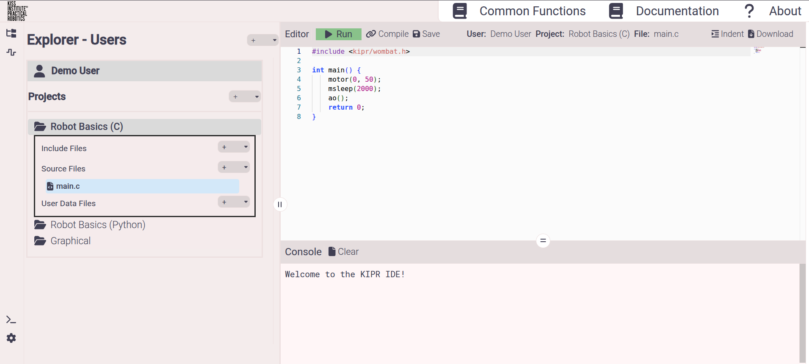

# Voldigate Portfolio Demo

A browser-based demonstration of **Voldigate**, KIPR's robotics programming IDE, adapted to showcase its programming environment, project management, and educational tools without requiring physical robotics hardware.

**[🚀 Try the Live Demo](https://voldigate-portfolio.vercel.app)**

## Overview

Voldigate is an integrated development environment (IDE) for the KIPR Wombat robotics controller, developed for educational robotics programming at the KISS Institute for Practical Robotics (KIPR).

I designed, built, and implemented the full Voldigate IDE for the Wombat robotics platform, creating a programming environment that supports robotics development and education.

This portfolio project showcases that work through a browser-based adaptation of Voldigate, allowing visitors to explore the IDE's programming environment, graphical editor, documentation, and project management features without requiring physical robotics hardware.

The demo demonstrates both my experience developing a complete robotics IDE and my ability to adapt an existing application for standalone web deployment.

## Screenshots

### Programming Environment



*The main programming environment, featuring project navigation and code editing.*

### Graphical Programming


*The Blockly-based graphical editor for visual programming.*

## Features

### Programming Environment
- C, C++, and Python code editing
- Monaco Editor integration
- Blockly-based graphical programming
- File and project management
- Syntax highlighting and language-specific editing

### Documentation
- Integrated libkipr API documentation
- Programming reference material accessible within the IDE

### Project and User Management
- Create, open, and manage projects
- Create and organize project files
- Manage demo users and classrooms
- Associate users with classrooms
- Save changes using browser localStorage

### Browser-Based Demo Mode
- No physical robotics hardware required
- No native hardware libraries required to run the browser demo
- Browser-based data persistence
- Deployable as a static web application

## Technology Stack

| Technology | Purpose |
|---|---|
| React | User interface |
| TypeScript | Type-safe application development |
| Redux | Application state management |
| Monaco Editor | Code editing |
| Blockly / KIPR Scratch | Graphical programming |
| Ivygate | KIPR user interface components |
| Webpack | Application bundling |
| localStorage | Browser-based demo persistence |
| Python | Build dependency preparation |
| Vercel | Hosting and deployment |


## My Contributions

### Original Voldigate IDE — Wombat Robotics Platform

**Designed, developed, and implemented the complete Voldigate IDE for the KIPR Wombat robotics controller.**

My work included developing and integrating the programming environment and its core functionality, bringing together the tools needed for robotics programming within a unified application.

Key areas of development included:

- **Application Architecture:** Designed and implemented the IDE's overall application structure and user experience.
- **Programming Environment:** Developed the integrated programming interface supporting C, C++, Python, and graphical programming.
- **Code Editing:** Integrated code editing tools and language-specific functionality.
- **Graphical Programming:** Integrated Blockly-based visual programming into the IDE.
- **Project Management:** Implemented functionality for organizing and managing robotics projects and source files.
- **Documentation Integration:** Incorporated programming documentation and API references into the development environment.
- **Robotics Platform Integration:** Developed the IDE for use with the KIPR Wombat robotics controller.

This work involved designing and implementing a complete software application that combines web technologies, programming tools, and robotics-specific functionality.

### Voldigate Portfolio Demo — Browser-Based Adaptation

To make my original Voldigate work accessible to prospective employers and other developers, I adapted the IDE into a standalone browser-based demonstration.

My contributions to the portfolio version include:

- **Browser-Only Demo Mode:** Adapted the application to operate without physical Wombat hardware.
- **Local Data Persistence:** Implemented localStorage-based management of projects, files, users, and classrooms.
- **Application Integration:** Adapted existing IDE components to operate with browser-managed demo data.
- **Graphical Programming:** Preserved the Blockly graphical programming interface in the hosted application.
- **Documentation:** Preserved integrated libkipr API documentation in the browser demo.
- **Build Configuration:** Modified dependency management and Webpack configuration to support deployment without native hardware compilation.
- **Deployment:** Configured and deployed the application on Vercel.

Together, these projects demonstrate my experience in **end-to-end software development, application architecture, React, TypeScript, IDE development, robotics software integration, and web deployment**.


## Building the Portfolio Demo

### Prerequisites

- Node.js
- Yarn 1.x
- Python 3 (for demo dependency preparation)

### Installation

Clone the repository:

```bash
git clone https://github.com/erinharrington-12/voldigate-portfolio.git
cd voldigate-portfolio
```

Install dependencies:

```bash
yarn install
```

### Build

Build the browser demo:

```bash
DEMO_MODE=true yarn build
```

If demo documentation dependencies need to be prepared separately, run:

```bash
python3 dependencies/build_voldigate_demo.py
```

The portfolio build uses pre-generated documentation and browser-compatible assets instead of requiring the full native Voldigate environment.

### Running Locally

Start the development server:

```bash
DEMO_MODE=true yarn start-dev
```

Open the local URL displayed by the development server.

## Demo Data and Persistence

The portfolio demo stores project, user, and classroom information in the browser's localStorage.

This allows visitors to create and modify demo content without requiring a backend database or authentication service.

**Important:**
- Demo data is stored locally in the current browser.
- Data is not synchronized across browsers or devices.
- Clearing browser storage removes locally saved demo data.
- Demo accounts are simulated and are not connected to production KIPR accounts.

## Demo Limitations

This project is intended to demonstrate Voldigate's user interface and browser-compatible development features.

The following limitations apply:

- Physical robotics hardware is not connected.
- Native hardware communication is unavailable.
- Browser-based demo accounts do not provide production authentication.
- Projects and classroom data are stored locally rather than in a remote database.
- Features requiring native execution or hardware access may not be available.

The demo preserves the programming environment and graphical editing experience while removing hardware requirements.

## Full Voldigate Build

The original Voldigate development environment includes native dependencies and additional build requirements.

The original dependency build script is retained:

```bash
python3 dependencies/build_voldigate.py
```

This process may require additional tools such as CMake, Make, SWIG, Doxygen, and native development libraries.

For the hosted portfolio demo, use the browser-based build instructions above.

## Deployment

The portfolio demo is hosted on Vercel and built from the `portfolio-demo` branch.

Deployment configuration:

| Setting | Value |
|---|---|
| Framework | Other |
| Build Command | `yarn build` |
| Output Directory | `dist` |
| Environment Variable | `DEMO_MODE=true` |

Updates pushed to the configured production branch can trigger a new deployment.

## About KIPR

The **KISS Institute for Practical Robotics (KIPR)** is an educational nonprofit organization focused on robotics education and hands-on STEM learning.

Voldigate is part of KIPR's robotics software ecosystem.

This repository is a portfolio demonstration based on the Voldigate project and is not intended to replace its production development environment.

## Links

- [Live Portfolio Demo](https://voldigate-portfolio.vercel.app)
- [GitHub Repository](https://github.com/erinharrington-12/voldigate-portfolio)
- [KISS Institute for Practical Robotics](https://www.kipr.org)
